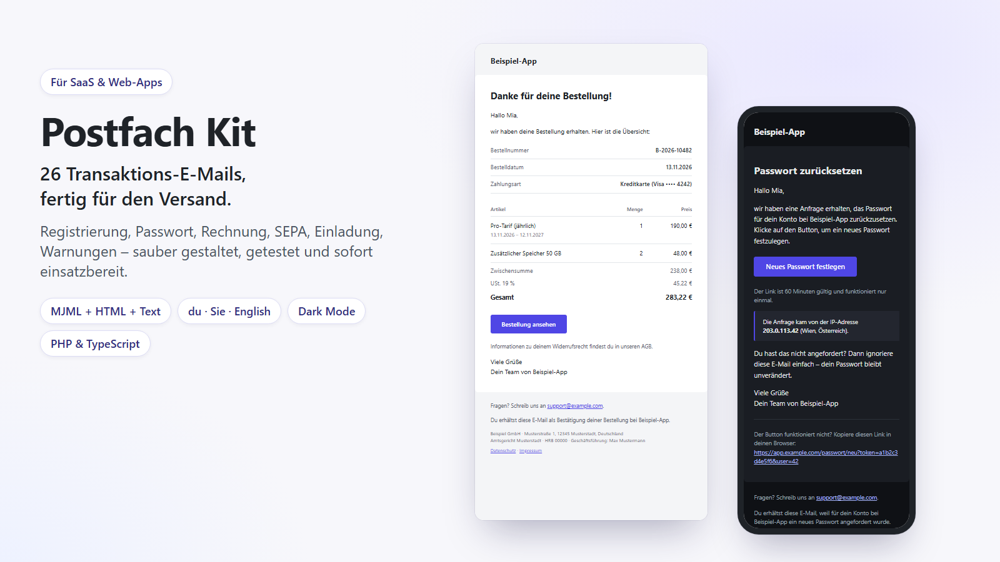

# Free MJML transactional email templates (EN/DE)

3 production-ready transactional emails for SaaS and web apps – **password reset, email confirmation and welcome** – in English and German, as **MJML, HTML and plain text**, with **dark mode**. Free under the MIT license.

This is a free sample of **[Postfach Kit](https://buy.polar.sh/polar_cl_XlOQhNv4z3TCmfe1TuZFD42YaQo8lN6Ht9sDw0XRyO8)** – 26 transactional emails with PHP and TypeScript renderers.

**[▶ Live preview of all 26 emails](https://www.ademkacar.com/projekt/postfach-kit/)**



## What's inside

| Template | Files |
|---|---|
| `password-reset` | `templates/en/password-reset.{html,txt,mjml}`, `templates/de/…` |
| `verify-email` | `templates/en/verify-email.{html,txt,mjml}`, `templates/de/…` |
| `welcome` | `templates/en/welcome.{html,txt,mjml}`, `templates/de/…` |

- **HTML** with Handlebars placeholders such as `{{reset_url}}` – use it with Handlebars, SendGrid Dynamic Templates or Mailgun templates.
- **Plain text** version for every email.
- **MJML** source – open it in the [MJML editor](https://mjml.io/try-it-live) to change colors, texts or layout.
- Dark mode, responsive, no Google Fonts, no tracking pixels.
- Tested light and dark in Apple Mail (iPhone), Gmail and Outlook on Windows.

## Usage (Node.js + Handlebars)

```js
import Handlebars from 'handlebars'
import { readFileSync } from 'node:fs'

const html = Handlebars.compile(readFileSync('templates/en/password-reset.html', 'utf8'))({
  user_name: 'Mia',
  reset_url: 'https://app.example.com/reset?token=…',
  expires_in_minutes: 60,
})
```

The sample brand is “Beispiel-App” – replace the name, colors and footer in the MJML files or HTML.

## Want all 26 emails?

**[Postfach Kit](https://buy.polar.sh/polar_cl_XlOQhNv4z3TCmfe1TuZFD42YaQo8lN6Ht9sDw0XRyO8)** adds:

- **23 more emails:** magic link, one-time code, new sign-in, team invitation, order confirmation with line items, receipt, invoice, failed payment, trial ending, subscription renewal and cancellation, refund, SEPA pre-notification, usage limit, comment notification, maintenance, data export, newsletter double opt-in, account deleted, terms updated …
- **German formal (“Sie”) version** of every email
- **One `theme.json`** for colors, logo and company details – rebuild all emails with one command
- **Renderers for PHP 8.1+ and Node.js/TypeScript** with types for every template, plus examples for Laravel, Symfony, PHPMailer, Nodemailer, Resend and Next.js
- Preview gallery, test sending and automated tests

## License

MIT – see `LICENSE`. Applies to the files in this repository only.

---

## Deutsch

3 kostenlose Transaktions-E-Mails (Passwort zurücksetzen, E-Mail bestätigen, Willkommen) auf Deutsch (du) und Englisch – als MJML, HTML und Text, mit Dark Mode. Kostenlos unter MIT-Lizenz.

Alle 26 Mails, die Sie-Fassung, eine `theme.json` für Farben und Logo sowie Renderer für PHP und TypeScript gibt es im **[Postfach Kit](https://buy.polar.sh/polar_cl_XlOQhNv4z3TCmfe1TuZFD42YaQo8lN6Ht9sDw0XRyO8)**.

**[▶ Live-Vorschau aller 26 Mails](https://www.ademkacar.com/projekt/postfach-kit/)**
